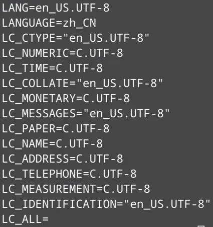
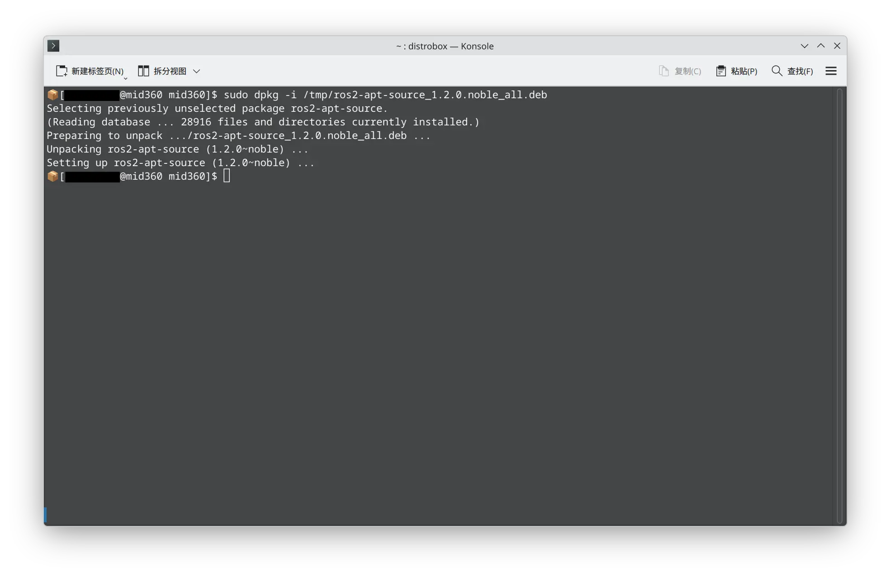

> ⚠️ **Pre-request**
> 
> 需要有 [Linux](../../linux/install.md) 环境

由于 ROS 1 已经停止了支持，所以在项目中我们使用的均为 ROS 2。这里选定的版本是 ROS 2 Jazzy，以 Ubuntu 24.04 为例。WSL2 或其他 Linux 发行版上运行的 Ubuntu 也是一样的。注意 ROS 版本是绑定对应的 Ubuntu 版本的，Jazzy 在 Ubuntu 22.04 上无法运行，同理，Humble 在 Ubuntu 24.04 上也是一样

# 设置 UTF-8 环境

逐条执行下面的命令

```shell
sudo apt update && sudo apt upgrade -y && sudo apt install locales -y
sudo locale-gen en_US en_US.UTF-8
sudo update-locale LC_ALL=en_US.UTF-8 LANG=en_US.UTF-8
export LANG=en_US.UTF-8

locale  # 验证设置
```

验证设置得到的结果应该类似 

# 设置软件源

```shell
sudo apt install software-properties-common -y
sudo add-apt-repository universe  # 按下 Enter 即可
```

逐条执行上述指令，添加软件源。然后打开 [此链接](https://github.com/ros-infrastructure/ros-apt-source/releases/)

在网页中搜索 `<ubuntu 代号>_all.deb`，比如 Ubuntu 24.04 的代号是 `noble`，就搜索 `noble_all.deb`，并将对应的文件下载下来


然后执行

```shell
sudo dpkg -i /path/to/ros2-apt-source_<version>.<ubuntu code>_all.deb
```

我下载到了 `/tmp` 下，版本是 `1.2.0`，Ubuntu 代号为 `noble`，所以执行了

```shell
sudo dpkg -i /tmp/ros2-apt-source_1.2.0.noble_all.deb
```

应该会看到类似下图 

# 安装 ROS 2 包

下面开始正式安装 ROS 2，这会花费一些时间

```shell
sudo apt update && sudo apt upgrade -y
sudo apt install ros-jazzy-desktop ros-dev-tool
```

结束之后就大功告成了，`ls /opt/ros/jazzy | grep set` 应该能看到 `/opt/ros/jazzy/setup.bash
` 